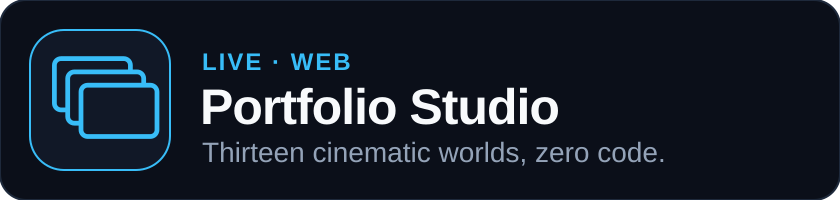

  
  
  

**I build end-to-end production software and ship it to real stores.** Right now that spans a voice-first habit app on iOS and Android, an automated multi-platform marketing engine with LLMs, and a cinematic no-code web platform. My engineering focus combines rock-solid full-stack architecture with applied AI.

**Live on 2 app stores** · **13 cinematic web templates** · **5 languages incl. Arabic** · **Playwright + axe tested**

 

A habit tracker where **voice is the core interaction**: say what you did and it's logged, so keeping a streak takes seconds.

- Voice-first logging and task management, with achievements, calendar sync, and streak analytics on top
- One Flutter + Firebase codebase shipped to both the App Store and Google Play
- Localized into English, Arabic, German, Spanish, and French

Flutter · Dart · Firebase · iOS · Android

 

Pick a template, fill in a form, and download a **scroll-driven, cinematic portfolio site**. No code, no Git, no terminal.

- 13 templates share one `portfolio.json` schema, so your content carries over when you switch worlds
- The site zip is built **in the browser** (JSZip), with SEO, a contact flow, and a plain-language publishing guide
- Reduced motion or no JavaScript falls back to a clean, readable page; every template has Vitest unit tests and Playwright + axe end-to-end suites

<b>See all 13 templates</b>

| Template | The story |
|---|---|
| **Case Board** | Your career pinned to a detective's crime board |
| **Tactics Board** | Your career as a football formation; the ball passes from role to role |
| **Stats Board** | Your data as statistics: lecture blackboard, dashboard, or journal |
| **The Vault** | A vault door swings open onto brass deposit boxes, one per role |
| **The Ledger** | Roles written into a ledger with a running balance of experience |
| **Inside the PC** | A PC boots to a git-log career, then the camera dives to the CPU, storage and network |
| **The Smile** | A 3D mouth with a case on each tooth |
| **Actuarial Science** | A 3D Galton board and a curve of accrued experience |
| **The Gallery** · **The Port** · **The Solar Farm** · **The Valley** · **The Archipelago** | …and more worlds to tell your story in |

Next.js · React · Three.js · React Three Fiber · Framer Motion · Lenis · JSZip · Vitest · Playwright · Vercel

 

### Also built

- **[awesome-curator](https://github.com/Ahmed-Elshaarawy/awesome-curator)**, open source: a Python tool that pulls trending repos by topic, validates every link asynchronously, and republishes an [awesome list](https://github.com/Ahmed-Elshaarawy/awesome-curator/blob/main/output/AWESOME.md) daily via GitHub Actions. Python · aiohttp · Jinja2 · Docker
- **[Masquerade Escape](https://globalgamejam.org/games/2026/masquerde-escape-9)**, Global Game Jam 2026: a complete, playable escape game built by a team in 48 hours, covering gameplay programming, design, and ruthless scope cuts. Unity · C#

### Toolkit

### 🏙️ 3D Contribution City Skyline

  <em>An isometric 3D skyline of <b>2,893 contributions</b> over the past year — each skyscraper height and spire is rendered in real time from daily git commits.</em>

  

 

### ⚡ Engineering Velocity & Stats

 

  
  &nbsp;&nbsp;
  

 

  

 

  <picture>
    <source media="(prefers-color-scheme: dark)" srcset="https://raw.githubusercontent.com/Ahmed-Elshaarawy/Ahmed-Elshaarawy/output/snake-dark.svg" />
    <source media="(prefers-color-scheme: light)" srcset="https://raw.githubusercontent.com/Ahmed-Elshaarawy/Ahmed-Elshaarawy/output/snake.svg" />
    
  </picture>

 

**Building something with voice, mobile, or the web?** I'd like to hear about it.

