  
  
  

### Software engineer who ships products end to end, with a specialization (and a deep love) for Machine Learning.

- 🚀 Shipping **Day Loop**, a voice-first habit tracker live on Google Play and the App Store
- 🎨 Building **Portfolio Studio**, a no-code builder for cinematic portfolio websites
- 🧠 Specializing in **Machine Learning** with PyTorch and TensorFlow
- 🎮 Making games in **Unity / C#**, including a Global Game Jam 2026 entry
- 💬 Ask me about **Flutter, Next.js, ML, or turning an idea into a shipped product**

  
  
  
  

 

<h2 id="day-loop"></h2>

> **Voice-first habit tracking: capture routines instantly, stay consistent, and level up your progress.**

Day Loop is a productivity & habit-tracking app where **voice interaction is the core feature**. Users can instantly log and manage habits through voice, making daily tracking faster, more natural, and easier to maintain. On top of that, Day Loop adds gamification, calendar sync, and real-time analytics to keep motivation high.

| | |
|---|---|
| **Voice-First Experience** | Log, manage, and interact with tasks and habits using voice commands |
| **Achievements** | Unlock badges as you hit milestones |
| **Calendar Sync** | Integrates with your existing calendar |
| **Analytics Dashboard** | Visual streak & progress tracking |
| **Premium Features** | Exclusive notifications & rewards |
| **Multilingual** | English · Arabic · German · Spanish · French |

**Built with:** Flutter · Dart · Firebase · Android · iOS

&nbsp;

 

<h2 id="portfolio-studio"></h2>

> **Pick a template, fill in a form, download a cinematic portfolio website. No code, no Git, no terminal.**

Portfolio Studio is a no-code website builder for people who want a portfolio that actually stands out. You choose a template, fill in your details in a guided form, watch a **live preview** update as you type, and download a ready-to-publish static site as a zip. Drop it on Netlify or Vercel and you're live in minutes.

Every template is a **scroll-driven, cinematic story** of your career, and your details carry over when you switch templates.

| Template | The story |
|---|---|
| **Case Board** | Your career pinned to a detective's crime board |
| **Tactics Board** | Your career as a football formation; the ball passes from role to role |
| **Stats Board** | Your data as statistics: lecture blackboard, dashboard, or journal |
| **The Vault** | A vault door swings open onto brass deposit boxes, one per role |
| **The Ledger** | Roles written into a ledger with a running balance of experience |
| **Inside the PC** | A PC boots to a git-log career, then the camera dives to the CPU, storage and network |
| **The Smile** | A 3D mouth with a case on each tooth |
| **Actuarial Science** | A 3D Galton board and a curve of accrued experience |
| **The Gallery** · **The Port** · **The Solar Farm** · **The Valley** · **The Archipelago** | …and more worlds to tell your story in |

**Highlights:**
- **13 templates** sharing one `portfolio.json` schema, so content is fully portable
- Live preview in an iframe, updated as you type
- The zip is built **in the browser** (JSZip), including SEO, a contact flow, and a plain-language publishing guide
- Accessible: reduced motion or no JavaScript falls back to a clean, readable page
- Tested with Vitest unit tests and Playwright + axe end-to-end suites per template

**Built with:** Next.js · React · Three.js · React Three Fiber · Framer Motion · Lenis · JSZip · Vitest · Playwright · Vercel

 

<h2 id="awesome-curator"></h2>

> **Auto-curate Awesome lists from GitHub: updated daily, zero manual effort.**

A Python open-source tool that fetches trending GitHub repositories by topic, validates every link asynchronously, and renders a clean Markdown awesome list via GitHub Actions on a daily schedule.

**Built with:** Python · PyGitHub · aiohttp · Jinja2 · Docker · GitHub Actions

&nbsp;

 

<h2 id="masquerade-escape"></h2>

> **Built a complete playable game in 48 hours, from concept to execution.**

A fast-paced escape experience developed during Global Game Jam 2026, focusing on rapid prototyping, gameplay design, and solving problems under extreme time constraints.

- Built in 48 hours
- Gameplay programming & design
- Team collaboration under pressure
- Rapid iteration & feature prioritization

**Tech used:** Unity · C#

 

<h2 id="stack"></h2>

**Languages**

  
  
  
  
  
  
  
  
  

**ML · Cloud · Tooling**

  
  
  
  
  
  
  
  
  
  
  

**Mobile · Web · Games**

  
  
  
  
  
  
  
  
  

 

<h2 id="activity"></h2>

  

  
  

 

<picture>
  <source media="(prefers-color-scheme: dark)" srcset="https://raw.githubusercontent.com/Ahmed-Elshaarawy/Ahmed-Elshaarawy/output/snake-dark.svg" />
  
</picture>
