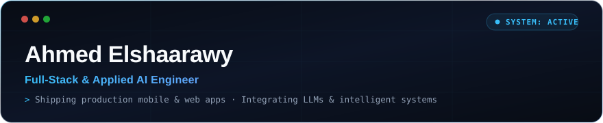

<div align="center">
  <a href="https://www.linkedin.com/in/ahmedelshaarawyy/" target="_blank" rel="noopener noreferrer">
    
  </a>

<br/>

[](https://portfoliostudio.me)
[](https://www.linkedin.com/in/ahmedelshaarawyy/)
[](mailto:am.elshaarawyy@gmail.com)

</div>

---

### About Me

Full-stack and applied AI engineer who builds and ships complete software products. I design architecture, write the code, and ship to production — from cross-platform mobile apps on app stores to cinematic web systems.

```yaml
role: Full-Stack & Applied AI Engineer
focus: Production Mobile & Web Systems, Applied AI/LLMs
craft: Flutter & Firebase, Next.js & Three.js, PyTorch & TensorFlow
current: Day Loop, Portfolio Studio, OctoGrow AI
shipped: 2 App Stores (iOS & Android), 13 Cinematic Web Worlds, 5 Languages
```

---

### Shipped Products

| Product | What it does | Platform / Status |
|---|---|---|
| **[Day Loop](https://apps.apple.com/eg/app/day-loop-daily-planner/id6762482526)** | Voice-first habit tracker & daily planner — speak to log streaks in seconds | **App Store** · **Google Play** |
| **[Portfolio Studio](https://portfoliostudio.me)** | 13 cinematic 3D worlds, zero code — in-browser static portfolio site builder | **Live Web** |
| **[awesome-curator](https://github.com/Ahmed-Elshaarawy/awesome-curator)** | Automated async repo discovery, concurrent link validation & daily updates | **Open Source (Python)** |
| **[Masquerade Escape](https://globalgamejam.org/games/2026/masquerde-escape-9)** | 3D escape room game prototyped, programmed, and shipped in 48 hours | **Global Game Jam 2026** |

---

### Featured Work

#### Day Loop — Voice-First Habit App

<a href="https://apps.apple.com/eg/app/day-loop-daily-planner/id6762482526" target="_blank" rel="noopener noreferrer">
  
</a>
&nbsp;
<a href="https://play.google.com/store/apps/details?id=devloopers.site.dayloop" target="_blank" rel="noopener noreferrer">
  
</a>

> **Talk to your habits.** A habit tracker where voice is the core interaction: say what you completed and it logs in seconds, eliminating manual tracking friction.

- **Voice-First Logging:** Speak your habits and routines; natural voice processing parses and records actions in seconds.
- **Gamified Streaks & Sync:** Integrated achievement badges, interactive streak calendar, and real-time habit analytics.
- **Production Flutter Architecture:** One unified Flutter + Firebase codebase serving both iOS and Android, localized into English, Arabic, German, Spanish, and French.

`Flutter` · `Dart` · `Firebase` · `iOS` · `Android` · `Voice UX`

<br>

#### Portfolio Studio — Cinematic Web Portfolio Engine

<a href="https://portfoliostudio.me" target="_blank" rel="noopener noreferrer">
  
</a>

> **Thirteen cinematic worlds, zero code.** Pick a world, fill in a form, and download a production-ready, scroll-driven 3D portfolio site built right in the browser.

- **13 Interconnected Worlds:** Every template shares one `portfolio.json` schema, allowing creators to hot-swap visual themes without re-entering data.
- **Client-Side Generation:** Packages the entire static site zip in-browser using JSZip, pre-configured with SEO metadata, contact flows, and deployment guides.
- **Automated Testing & Accessibility:** Full reduced-motion and non-JS fallback pages, validated by automated Vitest unit test suites and Playwright + axe accessibility pipelines.

<details>
<summary><b>Explore all 13 cinematic templates</b></summary>
<br>

| Template | The Story |
|---|---|
| **Case Board** | Your career pinned to a detective's crime board |
| **Tactics Board** | Your career as a football formation; the ball passes from role to role |
| **Stats Board** | Your data as statistics: lecture blackboard, dashboard, or journal |
| **The Vault** | A vault door swings open onto brass deposit boxes, one per role |
| **The Ledger** | Roles written into a ledger with a running balance of experience |
| **Inside the PC** | A PC boots to a git-log career, then the camera dives into the CPU, storage and network |
| **The Smile** | A 3D mouth with a case on each tooth |
| **Actuarial Science** | A 3D Galton board and a curve of accrued experience |
| **The Gallery** · **The Port** · **The Solar Farm** · **The Valley** · **The Archipelago** | …and more immersive worlds to showcase your story |

</details>

`Next.js` · `React` · `Three.js` · `React Three Fiber` · `Framer Motion` · `Lenis` · `JSZip` · `Vitest` · `Playwright` · `Vercel`

---

### What I Work With

<table>
<tr>
<td><b>Mobile & Frontend</b></td>
<td>


</td>
</tr>
<tr>
<td><b>AI & Machine Learning</b></td>
<td>


</td>
</tr>
<tr>
<td><b>Backend & Cloud</b></td>
<td>


</td>
</tr>
<tr>
<td><b>Languages & Games</b></td>
<td>


</td>
</tr>
</table>

---

### 3D Contribution City Skyline

<p align="center">
  <em>An isometric 3D skyline of <b>2,893 contributions</b> over the past year — each skyscraper height and glowing spire is rendered in real time from daily git commits.</em>
</p>

<div align="center">
  
</div>

---

### GitHub Activity & Velocity

<div align="center">
  <a href="https://github.com/Ahmed-Elshaarawy">
    
  </a>
  &nbsp;&nbsp;
  <a href="https://github.com/Ahmed-Elshaarawy">
    
  </a>
</div>

<br>

<div align="center">
  <a href="https://github.com/Ahmed-Elshaarawy">
    
  </a>
</div>

<br>

<div align="center">
  <picture>
    <source media="(prefers-color-scheme: dark)" srcset="https://raw.githubusercontent.com/Ahmed-Elshaarawy/Ahmed-Elshaarawy/output/snake-dark.svg" />
    <source media="(prefers-color-scheme: light)" srcset="https://raw.githubusercontent.com/Ahmed-Elshaarawy/Ahmed-Elshaarawy/output/snake.svg" />
    
  </picture>
</div>

---

<div align="center">

_Building production applications and intelligent systems that ship._

<br>

[LinkedIn](https://www.linkedin.com/in/ahmedelshaarawyy/) · [Portfolio](https://portfoliostudio.me) · [Email](mailto:am.elshaarawyy@gmail.com)

</div>
